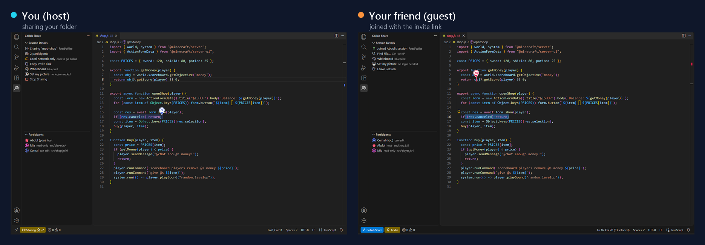
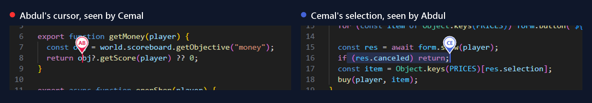
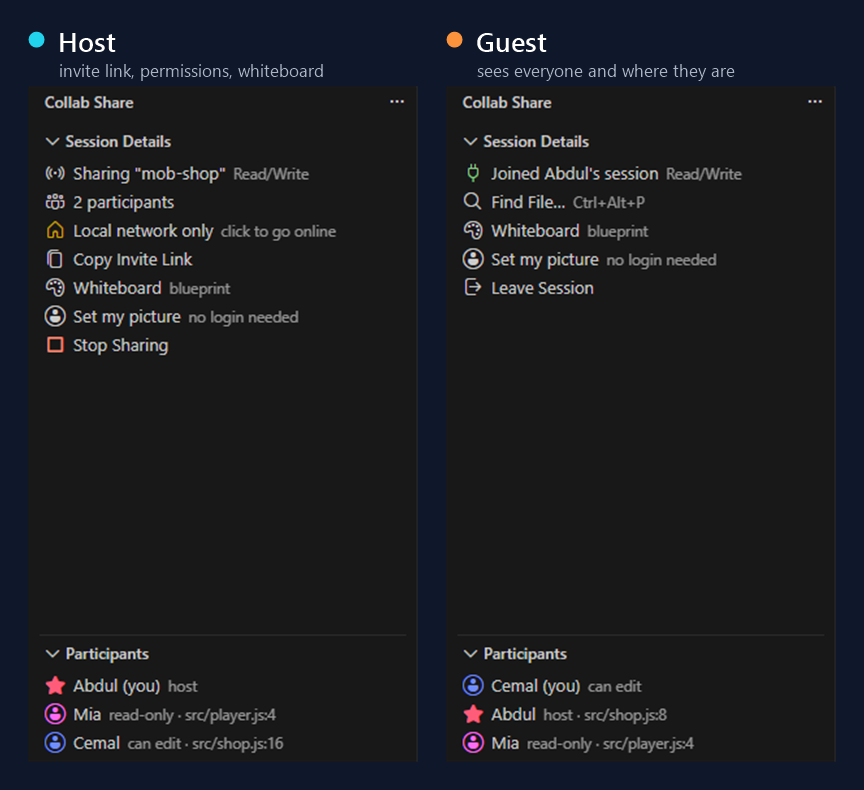
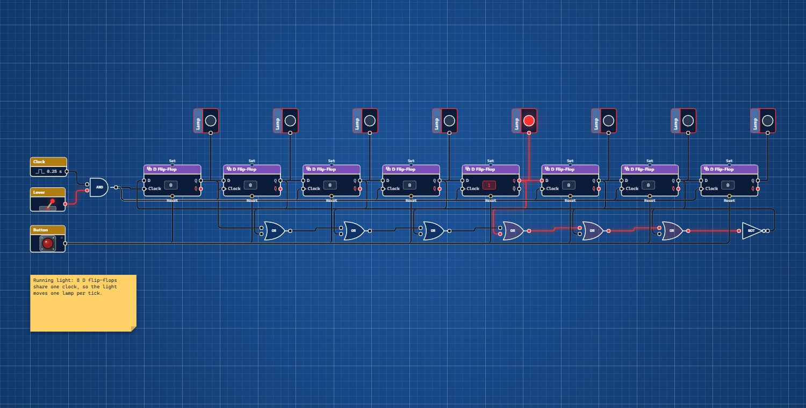
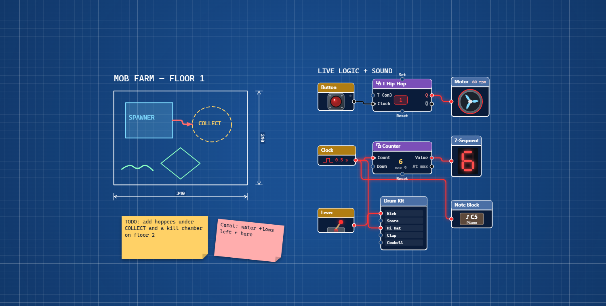

# Collab Share

**Code together in VS Code, in real time, with friends anywhere.** It's a free Live Share alternative: no account, no server, one invite link.

## Get started in 3 steps

| 1. Install | 2. Share | 3. Join |
| :-- | :-- | :-- |
| Everyone installs **Collab Share** from the Extensions view. | Open your project → **Collab Share** icon (left bar) → **Share**. The invite link is copied for you. | Your friend runs **Collab: Join Session** and pastes the link. Done. |

> Works over the Internet: the first time you share, one click downloads Cloudflare's free tunnel tool (host only, checked for safety, no admin rights). On the same Wi-Fi it works right away.

---

## See each other while you code

Everyone gets a **pin cursor** with their picture or initials. You see their selections, and which files they have open.
Click a name to **jump** to them, or press 📌 to **follow** them around the project.

## Everything in one panel

**Host:** invite link, Internet link status, **read-only / can edit** per person, **colors** per person, stop sharing.
**Guest:** who is here and where, find files, whiteboard, leave.

## A whiteboard with a real logic simulator

Wire up **logic gates, flip-flops (D, T, JK with Set/Reset), counters, clocks, delays, buttons, levers and lamps**. The circuit runs live for everyone at 20 ticks per second.

**Draw:** shapes, arrows, dimension lines, sticky notes, rotation, square or curved wires.
**Play:** motor, 7-segment display, drum kit, piano / 808 / phonk bell and more.
**Keep it:** save as a board file to open again later, or export a PNG.

## Also included

- ✅ **IntelliSense for guests** (completions, hover, go to definition, errors) from the host's language servers, including `node_modules` types.
- ✅ **Your own undo:** `Ctrl+Z` only undoes *your* typing.
- ✅ **Saving** from anyone saves the host's file.
- ✅ **Profile pictures** without logging in (GitHub username or any image).
- ✅ The session ends for everyone when the host stops or goes offline.

---

## Reference

### Hosting
1. Open the folder you want to share.
2. In the **Collab Share** sidebar click **Share (Read/Write)**, or **Share (Read-Only)** if friends should only watch.
3. Send the invite link that was copied to your clipboard. It looks like `wss://…trycloudflare.com/?token=…`.

The first time you host over the Internet, Collab Share asks once to download **cloudflared**, Cloudflare's free tunnel tool (about 40–55 MB; only the host needs it):
- it is the official file from Cloudflare's GitHub releases, pinned to a tested version;
- its SHA-256 fingerprint is checked, and a file that doesn't match is never run;
- it is stored inside the extension (no admin rights, nothing installed system-wide);
- a copy that's already installed on your computer is used instead.

Say "Not now" to share on your local network only. Windows may ask to allow VS Code through the firewall; that's only needed for local-network links.

### Joining
Run **Collab: Join Session** (or use the **Collab Share** icon in the left bar) and paste the link. A new window opens with the host's files. Use `Ctrl+Alt+P` to find files by name.

### Whiteboard
- **Tools:** select / move / resize, pen, line, arrow, rectangle, ellipse, diamond, dimension line, text, sticky note, eraser.
- **Style:** colors (including custom), line widths, dashed lines, fill, snap-to-grid.
- **Editing:** box select or Shift+click; copy / cut / paste / duplicate (`Ctrl+C` / `X` / `V` / `D`); front / back (`]` / `[`); arrow keys to nudge; double-click to edit; undo / redo.
- **Rotate:** drag the round handle (snaps to 15°, hold Shift for any angle), use ↺ / ↻, or press `Shift+R` / `Shift+L`.
- **Nodes (`G`):**
  - logic gates (AND, OR, NOT, NAND, NOR, XOR, XNOR, Buffer, 3-input AND/OR);
  - memory (D / T / JK flip-flops with Set on top and Reset at the bottom, SR latch, D latch, Counter);
  - timing (Clock, Delay, Pulse);
  - inputs (Push Button, Lever, Switch, Number);
  - outputs (Lamp, Motor, 7-Segment, Display);
  - sound (Note Block with 9 instruments, Drum Kit, Buzzer);
  - math (Clamp, Lerp, Add, Subtract, Multiply, Divide, Modulo, Min, Max, Abs, Select, >, <, =).
- **Wires:** drag from pin to pin. Red = on, black = off, gray = not connected. Double-click a module to change its setting.
- **Sound:** turn it on with the **Sound** button. Double-click a Note Block or Buzzer to pick the instrument or wave, then press **▶ Test sound**.

### Settings
| Setting | Default | Description |
| --- | --- | --- |
| `collab.displayName` | your user name | Name shown to others |
| `collab.port` | `7171` | Port the host listens on |
| `collab.shareOverInternet` | `true` | Create an Internet link when hosting |
| `collab.cloudflaredPath` | *(auto)* | Path to your own `cloudflared` |
| `collab.publicUrl` | *(empty)* | Your own tunnel URL (ngrok, VS Code Ports…) |

### Privacy and security
- There is no Collab Share server. Code goes directly from the host to the guests, through Cloudflare's tunnel when using an Internet link (encrypted, `wss://`).
- The only download is the optional cloudflared tool, and only after you agree.
- Each session has a fresh random link that stops working when you stop sharing. Guests can read **every file in the shared folder** (including `.env`), so only share with people you trust.
- Your picture or GitHub username is shared only if you choose **Set my picture**.

### Limitations
- There are no shared terminals or debugging.
- `Ctrl+Shift+F` search and `Ctrl+P` don't work in a guest window; use `Ctrl+Alt+P`.
- Everyone needs the same extension version. Joining with a different version is refused with a clear message.
